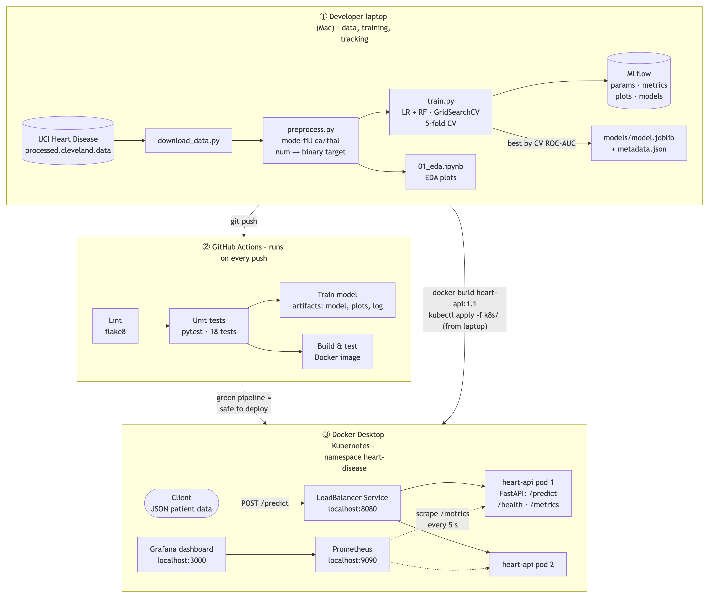
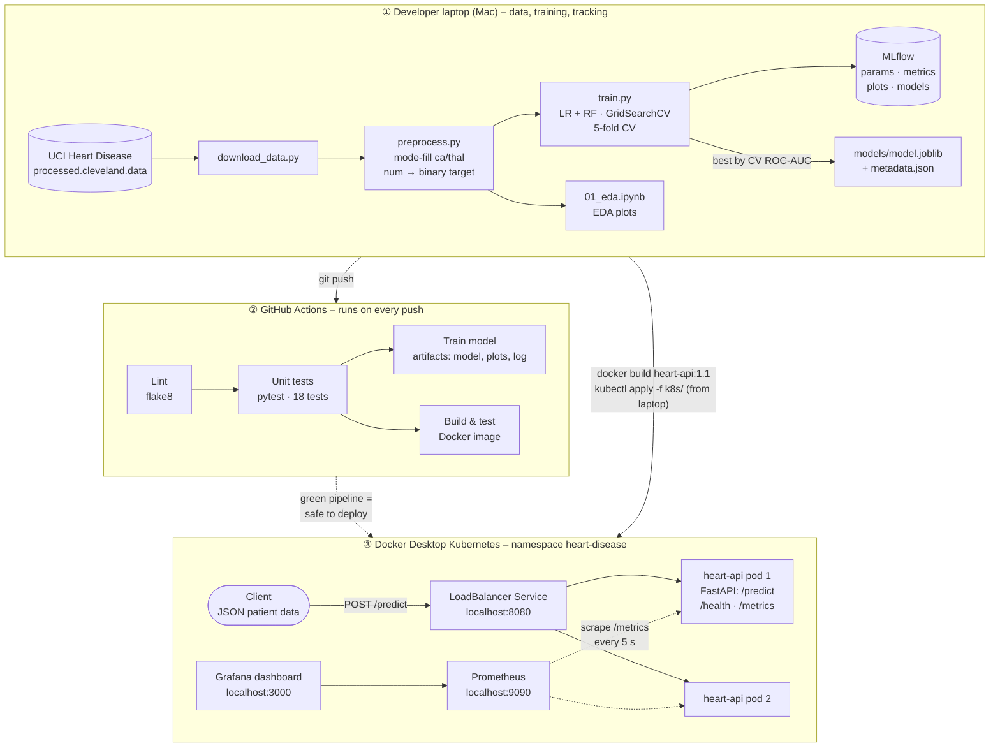

# Heart Disease Risk – MLOps Pipeline

Heart disease risk classifier trained on the UCI Cleveland dataset, tracked with MLflow, tested and built by GitHub Actions, and served as a monitored FastAPI service on Kubernetes.


## Architecture



Live version (source: [`docs/architecture.mmd`](docs/architecture.mmd)):



## Results

Test set: 61 patients (20% stratified hold-out). CV = 5-fold stratified cross-validation on the training set.

| Model | CV ROC-AUC | Test accuracy | Precision | Recall | Test ROC-AUC |
|---|---|---|---|---|---|
| Logistic Regression (**final**) | 0.907 | 0.869 | 0.8125 | 0.929 | 0.958 |
| Random Forest | 0.895 | 0.885 | 0.818 | 0.964 | 0.947 |

The final model is chosen by CV ROC-AUC, not by test score.

## Project structure

```
.
├── data/
│   ├── raw/                  # processed.cleveland.data (UCI, unchanged)
│   └── processed/            # heart_clean.csv (cleaned, binary target)
├── notebooks/01_eda.ipynb    # EDA: class balance, histograms, correlation heatmap
├── src/
│   ├── download_data.py      # download the raw file from UCI
│   ├── preprocess.py         # clean data -> data/processed/heart_clean.csv
│   ├── features.py           # feature groups + preprocessing (scaler, one-hot)
│   ├── train.py              # GridSearchCV for LR + RF, MLflow logging, save best model
│   ├── predict.py            # predict one patient from a JSON file
│   ├── app.py                # FastAPI service: /predict, /health, /metrics
│   └── generate_traffic.py   # send random requests to the API
├── tests/                    # 18 pytest tests: data, model, API
├── models/                   # model.joblib (pipeline) + metadata.json
├── k8s/                      # namespace, deployment (2 replicas), LoadBalancer service
│   └── monitoring/           # Prometheus + Grafana (with dashboard)
├── .github/workflows/ci.yml  # CI: lint -> tests -> train + Docker build/test
├── docs/architecture.mmd     # architecture diagram source (Mermaid)
├── screenshots/              # screenshots for every task
├── Dockerfile                # API image (python:3.12-slim, non-root, health check)
├── requirements.txt          # full pinned environment
├── requirements-api.txt      # API-only dependencies for the Docker image
└── sample_patient.json       # example request
```

## Setup

Requires Python 3.12.

```bash
git clone https://github.com/Vishnuvallabh/heart-disease-mlops.git
cd heart-disease-mlops
python3.12 -m venv venv
source venv/bin/activate
pip install -r requirements.txt
```

## Run the ML pipeline

```bash
python src/download_data.py               # -> data/raw/processed.cleveland.data
python src/preprocess.py                  # -> data/processed/heart_clean.csv (303 rows)
python src/train.py                       # -> models/model.joblib, models/metadata.json, MLflow runs
python src/predict.py sample_patient.json # -> {"prediction": 0, "label": "no disease", "confidence": 0.823}
```

View experiments (port 5001, because port 5000 is used by AirPlay on macOS):

```bash
mlflow ui --port 5001                     # http://localhost:5001 -> experiment "heart-disease"
```

## Tests and lint

```bash
flake8 src tests
pytest -v                                 # 18 tests
```

## Docker

```bash
docker build -t heart-api:1.1 .
docker run -d -p 8000:8000 --name heart-api heart-api:1.1
curl http://localhost:8000/health
curl -X POST http://localhost:8000/predict -H "Content-Type: application/json" -d @sample_patient.json
docker rm -f heart-api                    # stop and remove
```

## Kubernetes deployment (access instructions for local testing)

1. Docker Desktop → **Kubernetes** → create a cluster of type **kubeadm** and wait for "Kubernetes running".
2. Build the image and deploy:

```bash
docker build -t heart-api:1.1 .
kubectl config use-context docker-desktop
kubectl apply -f k8s/namespace.yaml && kubectl apply -f k8s/ && kubectl apply -f k8s/monitoring/
kubectl get all -n heart-disease
```

3. Open:

| Service | URL |
|---|---|
| API | http://localhost:8080 – `/docs`, `/health`, `/predict`, `/metrics` |
| Prometheus | http://localhost:9090 – Status → Target health |
| Grafana | http://localhost:3000 – login `admin` / `admin` → Dashboards → MLOps → Heart Disease API |

4. Generate traffic for the dashboard:

```bash
python src/generate_traffic.py http://localhost:8080 300
```

5. Clean up:

```bash
kubectl delete namespace heart-disease
```

## API example

`POST /predict` with [`sample_patient.json`](sample_patient.json):

```json
{"age": 63, "sex": 1, "cp": 1, "trestbps": 145, "chol": 233, "fbs": 1,
 "restecg": 2, "thalach": 150, "exang": 0, "oldpeak": 2.3, "slope": 3,
 "ca": 0, "thal": 6}
```

Response:

```json
{"prediction": 0, "label": "no disease", "confidence": 0.823}
```

Invalid input (missing field or out-of-range value, e.g. `"age": 500`) returns `422 Unprocessable Entity`.

## CI/CD

[`.github/workflows/ci.yml`](.github/workflows/ci.yml) runs on every push to `main` and on pull requests:

| Job | Steps | Artifacts |
|---|---|---|
| Lint (flake8) | flake8 + Kubernetes manifest validation | – |
| Unit tests (pytest) | `pytest -v`, after lint | `test-results` (JUnit XML) |
| Train model | download → preprocess → train → prediction smoke test, after tests | `model-and-reports` (model, metadata, plots, training log) |
| Build & test Docker image | build image, start container, check `/health` and `/predict`, after tests | – (container logs in job output) |

A failing job stops the jobs that depend on it.

## Reproduced on the BITS Prayogshala VM

The full pipeline (tasks 1–8) was re-run from a fresh clone on the Prayogshala lab VM, which runs RHEL 9. That run used Minikube instead of Docker Desktop:

```bash
minikube start --driver=docker
minikube image load heart-api:1.1
minikube kubectl -- apply -f k8s/namespace.yaml
minikube kubectl -- apply -f k8s/ -f k8s/monitoring/
minikube tunnel        # assigns external IPs to the LoadBalancer services
```

The evidence is in [`screenshots/vm/`](screenshots/vm/README.md): timestamped terminal captures, MLflow, Prometheus and Grafana screenshots, and the GitHub Actions run triggered from the VM.

## Report and video

- Report: [`report/MLOps_Assignment1_Report.pdf`](report/MLOps_Assignment1_Report.pdf) ([DOCX](report/MLOps_Assignment1_Report.docx))
- Video: _to be added_
